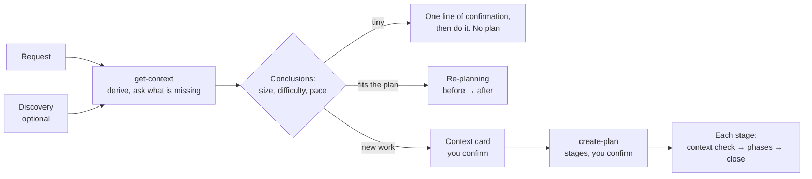

<p align="center">
  <h1 align="center"> Blueprint</h1>
  <p align="center"><b>Think it through with Claude before you build.</b></p>
  <p align="center">Blueprint takes a request from the first message to a staged plan — the context first, then stages built on written best practices — and gives every stage a fixed loop, checked by hooks, so Claude always knows where the work stands.</p>
</p>

<p align="center">
  
  
  
  
</p>

---

## Why

Claude Code forgets everything between sessions, and its plans live and die inside one chat.
On a real project that causes two problems. Claude starts building before it knows what matters
(who approves the result? is there a deadline? how costly is a mistake?). And by week 6 it no
longer knows which stage the work is in, or what was decided in week 1.

Blueprint fixes both. It finds out what shapes a plan before planning. It writes the plan to a
file that every session reads. It gives each stage a fixed loop, so a stage cannot be called
done before its tests, its review or its decisions exist.

> Writing code is becoming cheap; **deciding well** is not. I believe engineers are becoming
> architects and decision-makers, with AI agents as specialists and builders. So the source of
> truth should be the written decisions.

## How it works



1. **Context.** Every new request starts with `get-context`. It derives from the context what a
   plan needs to know (the request, the conversation, the repo, your rules) and asks only what it
   cannot derive. Then it draws the conclusions: how big the work is, how difficult, at what pace.
   A tiny request gets one line of confirmation and no files; work that fits the existing plan
   becomes a re-planning; new work gets a card (`blueprint/context.md`) that you confirm. No plan
   before that.
2. **Discovery (optional).** On code Claude doesn't know, Blueprint offers to read it first. It
   records the git baseline, writes the decisions it finds as unconfirmed, and fills the context
   answers the code already gives.
3. **Plan.** `create-plan` proposes the stages, discusses them with you, and writes
   `blueprint/plan.json` after your OK.
4. **Stages.** Each stage runs the loop of its type. Every loop starts with a **context check**:
   Claude must ask itself whether it has enough context to carry out the stage on its own, and
   fills the gap with you when it has not. At the opening it tells you that answer, the topics,
   the phases and how it would do the stage, and waits for your OK.

## Where Blueprint stops

Blueprint gives the **pipeline**: the plan says *what* (stages and their topics), the loop says
*which phases* each stage goes through. It also runs **discussions**: deciding is its trade
(`topic-discussion`).

**How** a stage is executed is up to you and your own tools: your skills, plugins, agents and
habits, the sessions, the git workflow, the review tool. Blueprint never names them and never
tells Claude how to use them. At the opening of a stage Claude proposes the "how" with what you
have, phase by phase when different tools serve different phases, you confirm, and the plan
records it in one line.

**Blueprint never hides your other plugins.** It decides only which phase the work is in; inside
any phase every plugin, skill and agent stays available. Example — a quick task "admin mockup":
the context check is a short discussion with Blueprint, the mockup is made with your design
plugin. In parallel work each session gets the tools its part needs.

The only contact point is **parallel work**. Blueprint knows work can run in parallel, so it plans
the shared contracts first and records which parts of a stage are independent.
*How* those parts are then built in parallel (how many sessions, how they talk) is not its
business.

## What the context must say

`data/context-questions.json` lists what a plan needs to know. It is **not a questionnaire**:
`get-context` derives each point from the context first (the repo, the conversation, an existing
card) and shows you what it derived. Only what it cannot derive becomes a question, one or two at a
time, as multiple choice with a recommendation, and it may ask other questions the work needs.
Context can also be fetched: you can ask Claude (or it can propose) to look online, run Discovery,
read a document or a link you point to, or wait while you ask someone.

Unless the work is tiny, the card is saved right away as a **draft**, with the points still unknown
marked `open`. If a Discovery or a long search pulls Claude away, or the session restarts, the
hooks see the draft and bring Claude back to the open points.

| id | If it must be asked | What it is for |
|---|---|---|
| `goal` | What do you want to achieve, and how will we know it is done? | the last stage and how it is verified |
| `kind` | Is it personal, for your company, or for a client? | pace, who approves, what goes into git |
| `approver` | Who approves the result? | delivery stages and pull requests |
| `timing` | Who decides the timing? Are there deadlines? | stage deadlines and pace |
| `existing` | What already exists: code, decisions, inherited constraints? | Discovery, what is not up for discussion |
| `risk` | How costly is a mistake? | how much to discuss, whether a decisions folder is needed |
| `constraints` | Budget, mandatory technologies, rules (personal data, NDA)? | choices already decided |
| `roles` | What do you decide, and what do you leave to Claude? | who decides each area |
| `parts` | Which parts is the work made of? | parallel work: contracts first |
| `documentation` | Do we keep a decisions folder, or is the card enough? | Claude proposes, you confirm |

From the answers Claude draws the **conclusions** and writes them at the top of the card: the
**size** (tiny, small, medium, project), the **difficulty** in one line, and the **pace**, which is
never asked ("personal, no deadline → calm"; "demo tomorrow → rushed"). On a running project with a confirmed card, a new request
reuses the answers that still hold and asks only what is new.

## The plan

`create-plan` reads the card, the stage loops, your own `CLAUDE.md` rules and its best practices:

1. **Aim to parallelize.** With 2 or more independent parts, discuss their shared contracts first,
   then build them in one implementation stage, in parallel.
2. **First what other things rest on.** Shared choices and contracts before the parts that use them.
3. **Unknowns first.** A quick task that finds out (cost, feasibility, access) before the
   discussion that needs it.
4. **Early feedback.** If someone else approves, an early mockup or demo.
5. **Work backwards from deadlines.** Rushed pace: less discussion, more parallel work, a plan B.
6. **Discuss what is hard to change.** Easy-to-change choices go to whoever owns the area.
7. **Every stage has a verifiable result.**
8. **One-line topics.** "Booking and cancellation", not "create `BookingService.ts`".
9. **Small stages.** "Database + API + login" in one stage gets split.
10. **Small work, small plan.** No stages for completeness.
11. **Try to break it.** For a project, a fresh agent may attack the plan before you see it.

How many stages (guidance, not a rule): tiny work → no plan; small → 1–3; medium → 2–5; a full
project usually lands around 8–12. Fewer on a full project usually means a stage is too big
(practice 9). Stages are never padded to reach a number.

### Stage types and their loops

Each stage has one type. The type's loop, in `data/loops.json`, says which phases the stage goes
through and what each phase must produce. It never says how.

| Type | For | Phases |
|---|---|---|
| `discussion` | deciding, no production code | context check → divergent proposal → convergence (you) → decision — for each topic |
| `implementation` | building parts; tests and review close it | context check → plan → build → test → review → *integrate* (you) |
| `delivery` | something to show, fast and low-risk: mockup, small demo on what exists, presentation, video, document | context check → prepare → *rehearse* (you) → deliver (you) → feedback |
| `quick_task` | a short, low-risk job: a mockup, an unknown to find out, a check, a small fix | context check → do → check → report (you) |

Every loop starts with the **context check** (`clarify`), and it is never skipped: Claude asks
itself whether it has enough context to carry out the stage on its own. Rarely "no" in a
discussion (the discussion is where context comes from), sometimes in an implementation or a
quick task, almost always in a delivery (who is it for? which format?). When the answer is "no",
the phase is a short discussion with you.

The **divergent proposal** opens the whole range of serious options first, then recommends one
and says why it wins. If you say the proposal misread the context, the topic goes back to the
context check. *Italic* phases are optional and are skipped only with a written reason. `test` and
`review` go back to `build` when they fail. A stage is done only after its last mandatory phase.
There is no separate verification type: checking what is built is the end of every
implementation.

### Topics

Topics say what a stage is about, one line each.
- In a **discussion** stage they are required: each topic is one decision, and goes through the
  phases on its own. A topic can be postponed, with a reason.
- In an **implementation**, **delivery** or **quick task** stage they are optional: they list the
  parts when there are several. A stage with one part ("Publish the site") has none.
- A topic is never a phase. "Rehearsal, Demo, Feedback" are the phases of a delivery, not its
  topics.
- Independent parts (`independent_parts`) are topics that can be built in parallel.

```json
{
  "id": "frontend-demo",
  "name": "Frontend demo",
  "type": "implementation",
  "status": "in_progress",
  "phase": "build",
  "independent_parts": ["Calendar", "Booking and cancellation"],
  "how": "the two parts in parallel on the fixed API contract",
  "topics": [
    { "name": "Calendar", "done": true },
    { "name": "Booking and cancellation", "done": false }
  ]
}
```

The plan changes when you ask, a deadline moves, the card changes, the work proves a decision
wrong or new work arrives. Claude proposes the change as **before → after**, you confirm, and done stages stay as
they are unless you ask.

## The files

Everything Blueprint keeps in a project sits in one folder, committed with the code, so every
branch sees the context, the plan and the decisions at its own version.

```
blueprint/
├── context.md      the context card: conclusions, then one line per point, with its source
├── plan.json       stages, topics, current phase, how, deadlines, independent parts
├── notes.json      optional notes per stage; new ones are mentioned at session start
└── decisions/      only when the card says the project needs it
    ├── _architecture.md   goal, components, graph, shared areas, contracts
    ├── _sections.md       the sections and what they depend on
    ├── _current-task.md   the discussion in progress
    ├── _audit.md          who changed which decision, when, and why
    ├── foundations/       shared choices: DB/DB.md, DB/DB--details.md …
    ├── contracts/         API, types, events — one per file
    └── sections/          pieces of value for your users
```

The decisions folder holds **only decisions**: those taken in discussions, and the corrections an
implementation or a delivery forces on them. Each decision is one small Markdown block (choice,
reversibility, who decided, rejected alternatives, why, the stage that took it). Your decisions and
every one-way decision go in the main file; two-way details Claude settled on its own go in
`--details.md`. It is plain Markdown, readable in Obsidian, in the language you speak with Claude.

The plugin's own data files are the same for everyone and Claude never edits them:
`data/context-questions.json` and `data/loops.json`.

## Hooks

| Hook | Event | What it guarantees |
|---|---|---|
| `orientation` | SessionStart | Claude reads where the work stands instead of remembering it: at most three short lines from `plan.json` (stage, phase or topics done, deadline, new notes), plus the discussion to resume. A draft context card → resume get-context from its open points. No plan → one line: every new request starts with get-context |
| `plan-guard` | PreToolUse on `blueprint/plan.json` | A valid plan: known types and phases, topics where required, phases in order, optional phases skipped only with a reason, going back only where the loop allows, done only after the last mandatory phase, no stage born done. Changing a done stage asks you first |
| `file-watcher` | PostToolUse | Every saved decision block is indexed and checked: contradictions, broken links, unreadable blocks, a missing or unknown stage |
| `one-way-guard` | PreToolUse on the decisions folder | A hard-to-change decision is never saved as decided by Claude alone. No permission mode bypasses it |
| `step-close` | Stop | At the end of a turn: is the context card still a draft (back to get-context, for example after a Discovery)? With code changes: is a phase finished (record it)? Did the work change something we decided (then the correction is written)? Each asked once |

Every check is a plain Node script: free to run, no model involved.

## Commands and skills

| Type | Name | What it does |
|---|---|---|
| Command | `/blueprint:blueprint` | Starts Blueprint in a repo: creates `blueprint/`, offers Discovery on unknown code, then starts get-context (`/blueprint` also works when nothing else has that name) |
| Command | `/blueprint:deep-review` | Optional, costs tokens. Agents re-read the decisions and their prose to catch contradictions of meaning |
| Skill | `using-blueprint` | How Blueprint works: the pipeline, hard rules, routing; read every session |
| Skill | `get-context` | Every new request: derive the context, ask what is missing, draw the conclusions, the card |
| Skill | `create-plan` | Best practices, stage types, `plan.json`, re-planning, opening and closing a stage |
| Skill | `topic-discussion` | The discussion engine: context check, specialists, one divergent proposal, your choice, the decision written |
| Skill | `discovery` | Reads an existing codebase; offered by `/blueprint:blueprint` or on request (there is no separate command) |
| Skill | `docs-management` | The format of `blueprint/` and the decisions folder |

## Install

```
claude plugin marketplace add FreddyZeta1847/blueprint
cd your-project
claude plugin install blueprint@blueprint --scope project
```

Use `--scope user` instead to enable Blueprint in every project. Then start `claude` in your
project and type `/blueprint:blueprint`.

Inside an active Claude Code session, the same steps are:

```
/plugin marketplace add FreddyZeta1847/blueprint
/plugin install blueprint@blueprint
```

To update:

```
claude plugin marketplace update blueprint
claude plugin update blueprint@blueprint
```

**Requirements:** Claude Code, Node.js (the hooks are Node scripts), git.

## What changed from 2.0

- **Scope.** Blueprint now covers the whole way from the first message to the plan, and the loop
  of every stage. How a stage is executed is left to your own tools.
- **New:** the `get-context` and `create-plan` skills, `blueprint/context.md` and
  `blueprint/plan.json`, the stage types and loops (`data/loops.json`), the `plan-guard` hook.
- **One folder.** Everything lives in `blueprint/`; the vault became the decisions folder
  `blueprint/decisions/`, created only when the project needs it. Who decides each area is the `roles` answer on the card.
- **No more entry gate.** The "does it touch the foundations?" question is gone: `get-context`
  sizes every request from its context.
- **Removed:** the `brainstorming`, `feature-detection`, `user-agent`, `management-info`,
  `engineering-sheets` and `pre-publish-check` skills, the `profile-updater` and `sheet-designer`
  agents, the path (`_queue.json`), `atoms.json` and `_full-context.md`. Ten skills became six.
- **Old vaults.** A 2.0 `vault-<project>/` folder is still read by the hooks, but it is not
  converted automatically.

## Good to know

- If your global `~/.claude/CLAUDE.md` describes a different planning workflow, or another plugin
  has its own planning skill, it can compete with Blueprint inside a Blueprint project.
- Without a plan the session-start hook stays silent, so for a tiny request Claude may not load
  Blueprint at all. If you want a confirmation line before every small change, say so in your own
  `CLAUDE.md`.
- Specialist discussions and `/deep-review` spend tokens; the checks don't.

## Repository layout

```
.claude-plugin/   plugin.json, marketplace.json
commands/         blueprint.md, deep-review.md
data/             context-questions.json, loops.json
skills/           6 skills (one folder each, SKILL.md)
hooks/            hooks.json, orientation.js, plan-guard.js, file-watcher.js, one-way-guard.js,
                  step-close.js, lib/ (shared code), tests/ (node --test hooks/tests/*.test.js)
PROGRESS.md       public, sanitized log of design milestones
TEST-FINDINGS.md  what the live test runs found, and what was fixed
```

## Status

v3.0.0 — the pipeline from the first message to a staged plan: a context derived before it is
asked, a plan built on written best practices, a fixed loop for every stage type (each opening
with a context check) checked by the plan-guard, and topics that say what each stage is about. Tested live on three scenarios: a new project, a running
project with one new task, and a series of tiny changes (see `TEST-FINDINGS.md`, run 5).

v2.0.0 — discuss only the foundations; Claude settles and records the details; a versioned vault
that separates your decisions from Claude's; an end-of-step check.

v1.1.0 — per-feature importance/effort scores and a per-project focus.

v1.0.0 — the core pipeline run end-to-end on a real test project.
