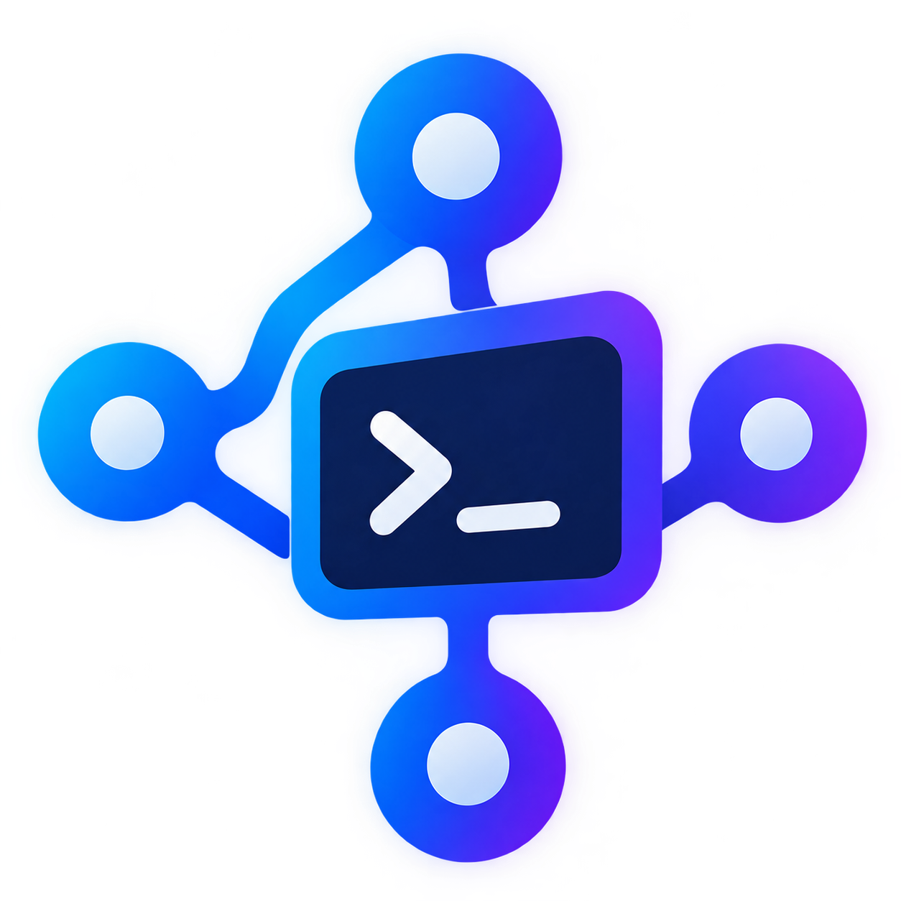
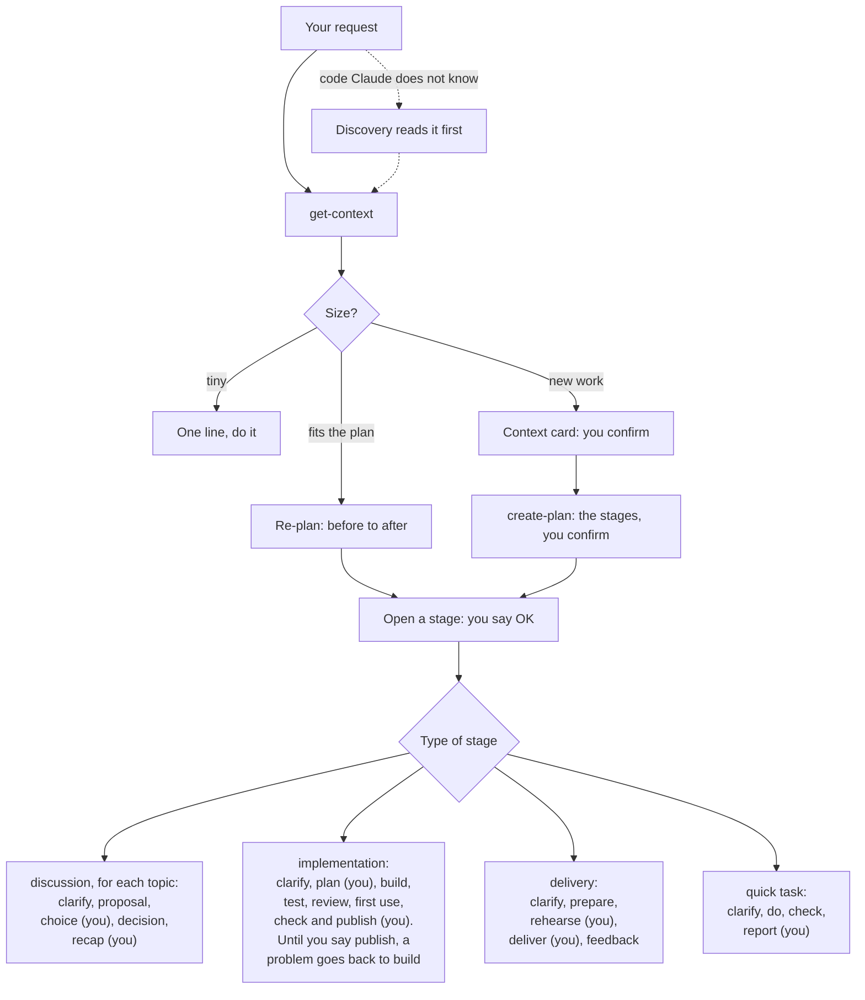

<p align="center">
  <h1 align="center"> Blueprint</h1>
  <p align="center"><b>Think it through with Claude before you build.</b></p>
  <p align="center">A Claude Code plugin that turns a request into a written context and a staged plan, gives each stage a fixed loop, and checks it with hooks, so Claude always knows where the work stands.</p>
</p>

<p align="center">
  
  
  
  
  
</p>

**Contents:** [Why](#why) · [How it works](#how-it-works) · [The panel](#the-panel) · [Install](#install) · [Reference](#reference) · [Status](#status)

## Why

Claude Code forgets everything between sessions, and its plans live and die inside one chat. It starts building before it knows what matters (who approves? is there a deadline? how costly is a mistake?). By week 6 it no longer knows which stage the work is in, or what was decided in week 1.

Blueprint finds out what shapes a plan before planning, writes the plan to a file every session reads, and gives each stage a fixed loop. A stage cannot be called done before its tests, review or decisions exist.

> Writing code is becoming cheap; **deciding well** is not. I believe engineers are becoming architects and decision-makers, with AI agents as builders. So the source of truth should be the written decisions.

Blueprint plans and discusses. **How** a stage is built (your tools, sessions, git workflow) is up to you. Blueprint never names your tools and never hides them.

## How it works



1. **Context.** `get-context` works out what a plan needs from the repo and the conversation. It asks only what is missing, then states the size, difficulty and pace. The result is the card `blueprint/context.md`, which you confirm. On code Claude does not know, `/blueprint:blueprint` first offers Discovery.
2. **Plan.** `create-plan` proposes stages with one-line topics, built on written best practices. After your OK it writes `blueprint/plan.json`.
3. **Stages.** Each stage runs the fixed loop of its type. Every loop starts with a context check: does Claude know enough to do this stage alone? A phase marked **(you)** waits for your answer.
4. **Hooks.** Plain Node scripts check the plan, the decisions and the phase changes. No model is involved, so they cost nothing.

## The panel

In a project with a plan, Blueprint opens a pane beside the chat. It rereads `blueprint/plan.json` every 5 seconds.

- **«Adesso» card.** Who works on what, what waits for you, and what went wrong (failed tests, open review findings). Each signal opens the stage on the right phase.
- **Plan.** One row per stage with a bar of its phases. Open a stage and step through its phases with the arrows.
- **Work tree** (implementation). The plain plan `blueprint/plans/<stage>.md`: session, letter A, Task A1, sub-task A1.1. The sub-task in progress colours the path above it. It holds only the build; you approve it, with the technical plan, before the build starts. A child session ticks a copy in its own folder.
- **Test counts.** Each group shows a fraction like «14/14», read from the real output of its test command.
- **Review dashboard.** Every round added up (fixed and open, per severity, per tool). Each open finding has a **Correggi** (fix) button. A new round is sent to Claude after 30 seconds. At most 3 rounds.
- **Decision cards** (discussion). Each decision shows if it is hard to change, who decided, and when opened, why and what was rejected.
- **Notes.** Add, edit or delete a note on a stage. Claude reads the new ones when the next session starts.
- **Sessions and Legend.** The mother session and one child per parallel part. A legend of the marks and of every stage type.

`/blueprint-panel` opens or closes it (`/blueprint-panel piano | sessioni | legenda` picks a screen). Two plugin options: `autoOpen` (on) opens it where there is a plan; `notifyWhenWaiting` (off) sends a phone notification when something waits for you. The panel follows Claude Code's language setting (Italian or English).

## Install

```
claude plugin marketplace add FreddyZeta1847/blueprint
cd your-project
claude plugin install blueprint@blueprint --scope project
```

Use `--scope user` to enable it in every project. Then start `claude` in your project and type `/blueprint:blueprint`.

Inside a running session:

```
/plugin marketplace add FreddyZeta1847/blueprint
/plugin install blueprint@blueprint
```

To update:

```
claude plugin marketplace update blueprint
claude plugin update blueprint@blueprint
```

**Requirements:** Claude Code, Node.js (the hooks are Node scripts), git.

## Reference

<details>
<summary><b>What the context must say</b></summary>

`data/context-questions.json` lists what a plan needs to know. It is not a questionnaire: each point is derived first, and only the gaps become questions (one or two at a time, multiple choice, with a recommendation). Unless the work is tiny, the card is saved at once as a draft, with unknown points marked `open`. If a session restarts, the hooks bring Claude back to them.

| id | What it asks | What it is for |
|---|---|---|
| `goal` | What do you want to achieve, and how will we know it is done? | the last stage and how it is verified |
| `kind` | Personal, for your company, or for a client? | pace, who approves, what goes into git |
| `approver` | Who approves the result? | delivery stages and pull requests |
| `timing` | Who decides the timing? Any deadlines? | stage deadlines and pace |
| `existing` | What already exists: code, decisions, constraints? | Discovery, what is not up for discussion |
| `risk` | How costly is a mistake? | how much to discuss, whether a decisions folder is needed |
| `constraints` | Budget, mandatory technologies, rules? | choices already decided |
| `roles` | What do you decide, and what do you leave to Claude? | who decides each area |
| `parts` | Which parts is the work made of? | parallel work: contracts first |
| `documentation` | A decisions folder, a single decisions file, or the card alone? | Claude proposes, you confirm |

The **size** is tiny, small, medium or project. The **pace** is never asked: «personal, no deadline» is calm, «demo tomorrow» is rushed.

</details>

<details>
<summary><b>Planning best practices</b></summary>

1. **Aim to parallelize.** With 2 or more independent parts, discuss their shared contracts first, then build the parts in parallel.
2. **First what other things rest on.** Shared choices and contracts come first.
3. **Unknowns first.** A quick task that finds out cost or feasibility comes before the discussion that needs it.
4. **Early feedback.** If someone else approves, plan an early mockup or demo.
5. **Work backwards from deadlines.** Rushed pace: less discussion, more parallel work, a plan B.
6. **Discuss what is hard to change.** Easy choices go to whoever owns the area.
7. **Every stage has a verifiable result.**
8. **One-line topics.** «Booking and cancellation», not «create `BookingService.ts`».
9. **Small stages.** «Database + API + login» in one stage gets split.
10. **Small work, small plan.** No stages for completeness.
11. **Try to break it.** For a project, a fresh agent may attack the plan before you see it.

Rough sizes: tiny means no plan, small 1–3 stages, medium 2–5, a full project about 8–12.

</details>

<details>
<summary><b>Stage types and their loops</b></summary>

The loops are in `data/loops.json`. They say which phases a stage goes through and what each must produce. They never say how.

| Type | For | Phases |
|---|---|---|
| `discussion` | deciding, no production code | context check, divergent proposal, convergence (you), decision, **recap** (you) — for each topic |
| `implementation` | building parts | context check, plan (you approve both plans), build, test, review, **first use** (Claude uses it, with concrete checks), **check and publish** (you try it; «publish» merges and releases it) |
| `delivery` | something to show: mockup, demo, document | context check, prepare, *rehearse* (you), deliver (you), feedback |
| `quick_task` | a short, low-risk job | context check, do, check, report (you) |

- *Italic* phases are optional and skipped only with a written reason. `test`, `review`, `first use` and `check and publish` go back to `build` when something is wrong.
- The **divergent proposal** lays out the serious options, then recommends one and says why.
- The **recap** reads back the question, the choice and the rejected options from what was written.
- **First use** is mandatory and tests do not replace it: Claude starts the work with the instructions you will get and uses it, ticking concrete checks chosen for the kind of project (an app, a firmware, an LLM system).
- **Check and publish** is yours and closes the stage: you try the work; until you say «publish», every problem is a correction inside the same stage (a new letter of the plan, the usual round, no confirmations, a test for each fixed error, a stop after 3 rounds). «Publish» merges the work and releases the version.
- A **topic** is one line of what a stage is about. In a discussion each topic is one decision. In other stages topics are optional and list parts. `independent_parts` are the topics that can be built in parallel.
- In an implementation, the plain plan `blueprint/plans/<stage>.md` is the index of the technical plan. Review findings go in `blueprint/reviews/<stage>.json`, with past rounds in `history`.

A stage in `plan.json`:

```json
{
  "id": "frontend-demo",
  "name": "Frontend demo",
  "type": "implementation",
  "status": "in_progress",
  "phase": "build",
  "independent_parts": ["Calendar", "Booking and cancellation"],
  "how": "the two parts in parallel on the fixed API contract",
  "topics": [
    { "name": "Calendar", "done": true },
    { "name": "Booking and cancellation", "done": false }
  ]
}
```

The plan changes when you ask, a deadline moves, or the work proves a decision wrong. Claude proposes the change as **before → after**, and you confirm.

</details>

<details>
<summary><b>The files in your project</b></summary>

Everything sits in one folder, committed with the code, so every branch sees the context, plan and decisions at its own version.

```
blueprint/
├── context.md      the context card: conclusions, then one line per point
├── plan.json       stages, topics, current phase, how, deadlines
├── notes.json      optional notes per stage
├── plans/          the plain plan of each implementation stage
├── checks/         test counts per group, read by the panel
├── reviews/        review findings per stage, with past rounds
├── decisions.md    the single decisions file, for light work
└── decisions/      the decisions folder, only when the card says the project needs it
    ├── _architecture.md, _sections.md, _current-task.md, _audit.md
    ├── foundations/    shared choices
    ├── contracts/      API, types, events
    └── sections/       pieces of value for your users
```

You get one place for decisions, chosen with the card: the folder, the single file `decisions.md`, or the card alone. The folder holds only decisions. Each is a small Markdown block: choice, reversibility, who decided, rejected options, why, and the stage. Your decisions and every hard-to-change one go in the main file. Details Claude settled alone go in `--details.md`. It is plain Markdown, readable in Obsidian.

</details>

<details>
<summary><b>Hooks</b></summary>

| Hook | Event | What it guarantees |
|---|---|---|
| `orientation` | SessionStart | Claude reads where the work stands: a few short lines from `plan.json`, new notes, plus any discussion to resume or draft card to finish. In a child session: the main folder's plan, and a warning when the child has no copy of the plain plan |
| `plan-guard` | PreToolUse on `plan.json` | A valid plan: known types and phases, phases in order, optional ones skipped only with a reason, done only after the last mandatory phase with every topic done. A finished stage cannot be changed without asking you |
| `file-watcher` | PostToolUse | Saved decisions are indexed and checked for contradictions and broken links |
| `one-way-guard` | PreToolUse on the decisions folder | A hard-to-change decision is never saved as decided by Claude alone. No permission mode bypasses it |
| `step-close` | Stop | At the end of a turn: is the card still a draft? Is a phase finished? Did the work change a decision? Each asked once |

</details>

<details>
<summary><b>Commands and skills</b></summary>

| Type | Name | What it does |
|---|---|---|
| Command | `/blueprint:blueprint` | Starts Blueprint in a repo, offers Discovery on unknown code, then starts get-context |
| Command | `/blueprint:deep-review` | Optional, costs tokens. Agents re-read the decisions to catch contradictions of meaning |
| Skill | `using-blueprint` | The pipeline, hard rules and routing |
| Skill | `get-context` | Derive the context, ask what is missing, write the card |
| Skill | `create-plan` | Best practices, stage types, `plan.json`, re-planning |
| Skill | `topic-discussion` | The discussion engine: one divergent proposal, your choice, the decision written |
| Skill | `discovery` | Reads an existing codebase first |
| Skill | `docs-management` | The format of `blueprint/` and the decisions folder |

</details>

<details>
<summary><b>What changed from 2.0</b></summary>

- Blueprint now covers the whole way from the first message to the plan, plus each stage's loop.
- New: `get-context`, `create-plan`, `blueprint/context.md`, `blueprint/plan.json`, `data/loops.json`, the `plan-guard` hook.
- One folder: the vault became `blueprint/decisions/`, created only when needed.
- The «does it touch the foundations?» gate is gone: `get-context` sizes every request.
- Removed: the `brainstorming`, `feature-detection`, `user-agent`, `management-info`, `engineering-sheets` and `pre-publish-check` skills, and the `profile-updater` and `sheet-designer` agents. Ten skills became six.
- A 2.0 `vault-<project>/` folder is still read by the hooks, but not converted.

</details>

<details>
<summary><b>Good to know</b></summary>

- A global `CLAUDE.md` with another planning workflow, or another planning plugin, can compete with Blueprint.
- Without a plan the session-start hook is silent, so for a tiny request Claude may not load Blueprint. Say so in your `CLAUDE.md` if you want a confirmation line before small changes.
- Discussions with specialists and `/blueprint:deep-review` spend tokens. The hook checks do not.

</details>

<details>
<summary><b>Repository layout</b></summary>

```
.claude-plugin/   plugin.json, marketplace.json
commands/         blueprint.md, deep-review.md
data/             context-questions.json, loops.json
skills/           6 skills (one folder each, SKILL.md)
hooks/            hooks.json, the Node hooks, lib/, tests/ (node --test hooks/tests/*.test.js)
hooks/panel.tsx   the panel (TSX), with its parts and tests in hooks/panel/ (claude plugin test .)
types/            the panel's types
assets/           the logo
PROGRESS.md       log of design milestones
TEST-FINDINGS.md  what the live test runs found, and what was fixed
```

</details>

## Status

v3.6.0 — an implementation stage ends with your «check and publish»: until you say publish, every problem is a correction in the same stage (a new letter of the plan, the usual round, no confirmations, a test for each fixed error, a stop after 3 rounds); the first use has concrete checks chosen for the kind of project. v3.5.3 — the same as v3.5.1 (the 3.5.2 work tree is withdrawn for now). v3.5.1 — fixes from a real parallel build: the plan holds only the build and is approved whole, red test runs are counted, child sessions tick a copy of the plan and are warned when it is missing, a contract is tried before the children start, and a lighter panel and skill list. v3.5.0 — the panel as a dashboard. Older versions: see [PROGRESS.md](PROGRESS.md).
