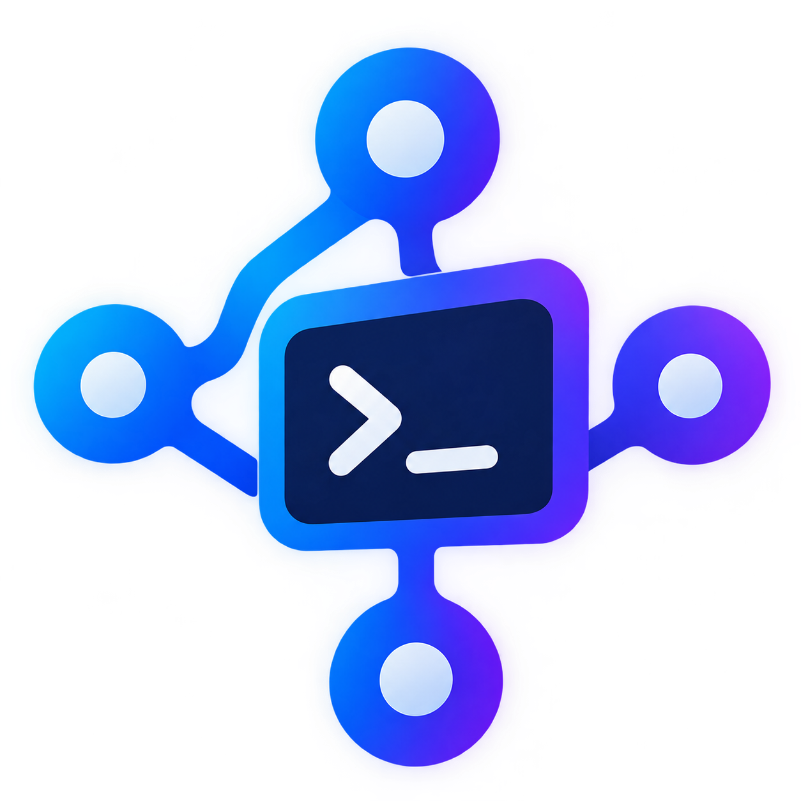
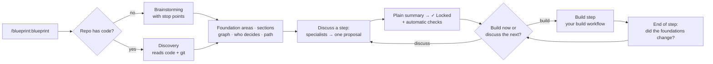

<p align="center">
  <h1 align="center"> Blueprint</h1>
  <p align="center"><b>Think it through with Claude before you build.</b></p>
  <p align="center">Blueprint discusses the foundations of your project with specialist agents, lets Claude settle the details, and keeps every decision in a versioned Obsidian vault that Claude reads every session — so nothing gets forgotten or silently contradicted.</p>
</p>

<p align="center">
  
  
  
  
</p>

---

## Why

Claude Code forgets everything between sessions. Plan Mode plans live and die inside one
chat. That's fine for a single task, but on a real project it causes a specific problem: in
week 1 you decide the app uses PostgreSQL and session cookies; in week 6, Claude has no memory
of that and can quietly build something that contradicts it.

Blueprint fixes this by making decisions **permanent and checked**. The choices that are
expensive to get wrong are discussed with you; everything else Claude decides and writes down.
Every decision lives in the vault and is checked against the others automatically.

> Writing code is becoming cheap; **deciding well** is not. I believe engineers are becoming
> architects and decision-makers, with AI agents as specialists and builders. So the source of
> truth should be the written decisions.

## How it works



1. `/blueprint:blueprint` (or `/blueprint`) sets up `vault-<project>/` in your repo. An empty
   repo starts **Brainstorming**; an existing codebase goes through **Discovery**, which records
   the git baseline, drafts the areas and writes the decisions it finds in the code as
   unconfirmed.
2. **Brainstorming** is a conversation that stops and waits at every phase. It ends with:
   - the **foundation areas** — the shared choices that are expensive to get wrong (DB, cloud,
     CI/CD, auth, API contracts…);
   - the **sections** — the pieces of value for your users (booking, sign-up…);
   - the dependency **graph**;
   - **who decides each area**: you, or Claude;
   - a proposed **path**, where discussion, prototypes, mockups and building alternate.
3. **Topic-Discussion** handles one step at a time. It dispatches the **specialist agents** that
   fit the area, and they bring back options. Claude turns their work into **one short
   proposal**, with the hard-to-change choices highlighted. You discuss only those.
   Your objections go back to the specialists.
4. Each discussion ends with one **plain summary**, saying what is **one-way** (hard to change
   later) and what is **two-way** (easy to change later). You confirm, and it becomes
   "✓ Locked".
5. After every step Claude asks: **"build this now, or discuss the next one?"** When code
   changed, a hook makes it ask whether the work changed the foundations.

## Who decides each area

| | What happens |
|---|---|
| **Areas you decide** | You confirm every decision. Small details Claude settled are listed in the summary, so you can object. |
| **Areas Claude decides** (the user agent) | Claude locks the two-way decisions on its own and records them in a separate details file. Anything one-way still comes back to you. |

The one-way rule is enforced by a `PreToolUse` hook. No permission mode can bypass it.

## The vault

Plain Markdown, versioned in your repo (so every branch and worktree sees the decisions at its
own version), readable in Obsidian. It is written in the language you speak with Claude.

```
vault-<project>/
├── _architecture.md        TOP: goal, components, graph, areas, contracts
├── _sections.md            the sections and what they depend on
├── foundations/
│   └── DB/
│       ├── DB.md           your decisions and every one-way decision
│       └── DB--details.md  two-way details Claude decided on its own
├── contracts/              API, types, events — one per file
├── sections/
├── _queue.json             the path
├── local-profile.md        who decides each area
├── _current-task.md        the discussion in progress
├── _full-context.md        full discussion record (not versioned)
└── _audit.md               who changed which decision, when, and why
```

Each decision is one small Markdown block (choice, reversibility, who decided, rejected
alternatives, why, dependencies). A hook turns the blocks into an index and checks them for
contradictions; nobody writes JSON by hand. In Obsidian's graph, foundations, contracts,
sections and Claude's details each get their own colour.

A new Claude session reads the vault automatically at startup: the vault **is** Claude's memory.

## What's inside the plugin

| Type | Name | What it does |
|---|---|---|
| Command | `/blueprint:blueprint` | Sets up the vault and starts the pipeline |
| Command | `/blueprint:deep-review` | Optional. Agents re-read decisions and prose to catch subtle contradictions (costs tokens) |
| Skill | `using-blueprint` | Rules, the entry step, routing; loaded every session |
| Skill | `brainstorming` | Areas, sections, graph, who decides, path |
| Skill | `discovery` | Turns an existing codebase into draft areas and decisions |
| Skill | `feature-detection` | New work on a running project: does it touch the foundations? |
| Skill | `topic-discussion` | The discussion engine |
| Skill | `docs-management` | The vault's format |
| Skill | `user-agent` | Who decides each area, plus a learned global preference profile |
| Skill | `management-info` | Project rules and documentation rules |
| Skill | `pre-publish-check` | Optional check of your own diff against the decisions before a push |
| Skill | `engineering-sheets` | Optional HTML visual reference built from the decisions |
| Agent | `profile-updater` | Updates the global profile (`~/.claude/blueprint/profile.json`); never saves without your OK |
| Agent | `sheet-designer` | Renders the engineering sheets |
| Hook | `SessionStart` | Short orientation: the current step of the path, what to resume |
| Hook | `PostToolUse` | Indexes and checks every decision save, keeps the changelog and the discussion record |
| Hook | `PreToolUse` | The one-way guard |
| Hook | `Stop` | End of step: "did this work change the foundations?" — once per set of changes |

## Install

```
claude plugin marketplace add FreddyZeta1847/blueprint
cd your-project
claude plugin install blueprint@blueprint --scope project
```

Use `--scope user` instead to enable Blueprint in every project. Then start `claude` in your
project and type `/blueprint:blueprint`.

Inside an active Claude Code session, the same steps are:

```
/plugin marketplace add FreddyZeta1847/blueprint
/plugin install blueprint@blueprint
```

To update:

```
claude plugin marketplace update blueprint
claude plugin update blueprint@blueprint
```

Optional, so the global profile can be saved without a prompt every time: add this to your
user-level `~/.claude/settings.json`:

```json
{ "permissions": { "allow": ["Read(~/.claude/blueprint/**)", "Edit(~/.claude/blueprint/**)"] } }
```

**Requirements:** Claude Code, Node.js (the hooks are Node scripts), git.

## Who it's for

Medium or long-lived projects, where a decision from month one still has to hold in month six.
For a quick script, plain Plan Mode is enough.

## Good to know

- If your global `~/.claude/CLAUDE.md` describes a different planning workflow, or another plugin
  has its own brainstorming skill, it can compete with Blueprint. Blueprint's rules say it wins
  inside a Blueprint project, but a global CLAUDE.md is strong.
- 2.0.0 changes the vault layout. Vaults made with 1.x (`features/`) are still read by the hooks
  but are not converted automatically.
- The optional parts (`/deep-review`, `pre-publish-check`, `engineering-sheets`, `discovery`,
  `management-info`) are less battle-tested than the core pipeline.
- Nearly every check is a plain script, free to run. Specialist discussions, the optional
  commands and the profile update spend tokens.

## Repository layout

```
.claude-plugin/   plugin.json, marketplace.json
commands/         blueprint.md, deep-review.md
skills/           10 skills (one folder each, SKILL.md)
agents/           profile-updater, sheet-designer
hooks/            hooks.json, orientation.js, file-watcher.js, one-way-guard.js, step-close.js,
                  lib/ (shared code), tests/ (node --test hooks/tests/*.test.js)
PROGRESS.md       public, sanitized log of design milestones
TEST-FINDINGS.md  what the live test runs found, and what was fixed
```

## Status

v2.0.0 — discuss only the foundations; Claude settles and records the details; a versioned vault
that separates your decisions from Claude's; decisions written as Markdown and indexed by a script;
a path where discussion and building alternate; an end-of-step check. Tested live on an 18-turn
run (see `TEST-FINDINGS.md`, run 3).

v1.1.0 — per-feature importance/effort scores and a per-project focus.

v1.0.0 — the core pipeline run end-to-end on a real test project.
