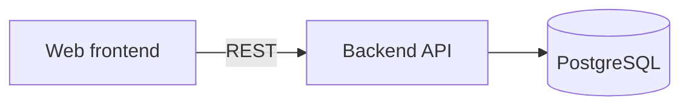
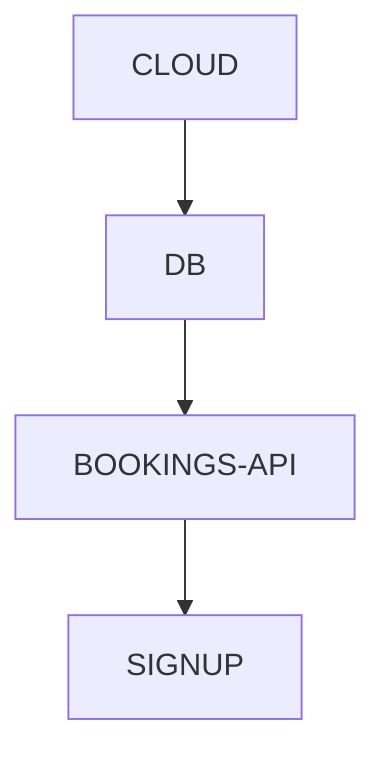

# Docs Management

<!--
Header comment (Markdown has no native comment syntax, so this HTML comment stands in for one):
the canonical file schema of the Blueprint plugin, v3. Every other Blueprint skill points here
instead of carrying its own copy. The hooks (file-watcher, one-way-guard, plan-guard,
orientation, step-close) parse exactly the formats defined below, so the block format, the
Decided-by values and the folder names are an interface, not a style choice. Change them only
together with hooks/.
-->

The single source of truth for where Blueprint's files live and how they are written. The **main
session is the only writer** of `blueprint/`. Agents (specialists, search helpers) may read it;
none of them writes it.

## 1. The `blueprint/` folder

Everything Blueprint keeps in a project sits in one folder at the repo root:

| File | Written by | What it holds |
|---|---|---|
| `blueprint/context.md` | Claude, after the user's yes | the context card: one answer per context question, with its source. Format in `blueprint:get-context` §7 |
| `blueprint/plan.json` | the main session only, after the user's OK | stages, topics, current phase, how, deadlines, independent parts. Format in `blueprint:create-plan` §5; checked by the plan-guard hook |
| `blueprint/notes.json` | the user (optional) | notes per stage: `{ "notes": [{ "stage": "<id>", "text": "...", "read": false }] }`. Read them when a stage opens; mark them `read` once told to the user |
| `blueprint/decisions/` | Claude, checked by the hooks | **only decisions**: those taken in discussions, and the corrections an implementation or a delivery forces on them — filed by shared area, contract and section. Created **only when the card's `documentation` answer says a decisions folder is needed** |
| `blueprint/decisions.md` | Claude | the **single decisions file**, when the card's `documentation` answer chose it: one `## <stage name>` section per stage, one bullet per decision (`- **<the choice>** — why; one-way/two-way; decided by user/Claude; date`). Every stage type writes here: discussions, implementation corrections, the choices a delivery's feedback rounds settle ("warmer colours, no dark backgrounds"), quick tasks. Not parsed by the hooks |

**Where a stage writes its decisions**, by the card's `documentation` answer: decisions folder →
`blueprint/decisions/`; single file → `blueprint/decisions.md`; card alone → the card's
`## Decisions` section. This holds for **every** stage type, not only discussions: a choice settled
in a quick task or in the feedback of a delivery is a decision too, and it must not live only in the
chat.

Other folders that the execution of a stage may create inside `blueprint/` are not Blueprint's: never
read them as decisions and never write them from a Blueprint step.

- Create every file with the `Write` tool (it creates parent folders). Never build files with
  shell redirection: on Windows it can produce UTF-16 files that every reader then sees as garbage.
- A legacy v2 vault (`vault-<project>/` at the repo root) is still read by the hooks; never create
  a new one there.

## 2. The decisions folder — hierarchy and structure

Three levels, kept visibly separate:
1. **`_architecture.md`** — the entry point. Goal, global defaults, components and how they
   communicate, the dependency graph, links to every foundation area and contract.
2. **Foundations and contracts** — the shared choices that are expensive to get wrong
   (`foundations/`, `contracts/`).
3. **Sections** — pieces of user value that *use* the foundations (`sections/`).

Inside every area and section, decisions are split by who made them:
- the main file (`AREA.md`, `SECTION.md`) holds decisions the user made or confirmed, rules,
  inherited/discovered decisions, and every one-way decision;
- `AREA--details.md` / `SECTION--details.md` holds **only** two-way decisions Claude made on its own.

```
blueprint/decisions/
├── .gitignore               derived files (§3)
├── _index.md                map of every file
├── _architecture.md         TOP: goal, defaults, components, graph, areas, contracts
├── _sections.md             table of sections
├── _current-task.md         the discussion in progress
├── _audit.md                decision changelog (hook-written)
├── _doc-rules.md            rules on how to write these docs (optional)
├── foundations/
│   ├── DB/
│   │   ├── DB.md            foundation decisions (user, rule, inherited, one-way)
│   │   └── DB--details.md   two-way decisions made by Claude
│   └── INTEGRATIONS/
│       └── <SYSTEM>.md      one file per external system: facts, unknowns, whom to ask
├── contracts/
│   └── <NAME>.md            one contract per file (API, types, events)
├── sections/
│   └── SIGNUP/
│       ├── SIGNUP.md
│       └── SIGNUP--details.md
├── Vocabulary/
│   ├── registry.json        shared question ids
│   ├── dismissed.json       findings the user ruled not real
│   └── ignored-values.json  absent-answer values the value-inversion check skips
└── _index/                  derived by the hooks, not versioned
```

Who decides each area is not a decisions file: it is the `roles` answer of the context card.

## 3. Creating the decisions folder

Create the decisions folder only when the confirmed card asks for one (usually right after the plan is
confirmed). Write each file with `Write`; for an empty folder write a `.gitkeep` inside it.

| File | Starting content |
|---|---|
| `.gitignore` | the lines below |
| `_index.md` | template (§11), no entries yet |
| `_architecture.md` | template (§11), sections empty |
| `_sections.md` | template (§11), empty table |
| `_current-task.md` | frontmatter `tags: [index]` + `# Current Task`, nothing else |
| `Vocabulary/registry.json` | `{ "entries": [] }` |
| `Vocabulary/dismissed.json` | `{ "entries": [] }` |
| `Vocabulary/ignored-values.json` | `{ "values": ["none", "n/a", "not-applicable", "default", "standard", "disabled", "tbd"] }` |
| `foundations/.gitkeep`, `contracts/.gitkeep`, `sections/.gitkeep` | empty |

```gitignore
_index/
**/modules.json
```

- Write the Markdown files in the user's language (§5); file and folder names stay as above.
- Every list file uses the `{ "entries": [...] }` wrapper, **never a bare `[]`**. Keep `yes` and
  `no` out of the ignored values on purpose: a yes/no choice means a question was written wrong.
- Not created here: `_audit.md` and `_index/` (the hooks create them), `_doc-rules.md` (only when
  the user gives rules on how to write the docs).
- If the decisions folder already exists, create only the missing files and never overwrite one.

## 4. Naming and versioning

| Type | Convention | Example |
|---|---|---|
| Foundation area | `foundations/AREA/AREA.md` — caps, hyphens | `foundations/CI-CD/CI-CD.md` |
| Area details | `foundations/AREA/AREA--details.md` | `foundations/DB/DB--details.md` |
| External system | `foundations/INTEGRATIONS/SYSTEM.md` | `foundations/INTEGRATIONS/STRIPE.md` |
| Contract | `contracts/NAME.md` — caps, hyphens | `contracts/BOOKINGS-API.md` |
| Section | `sections/SECTION/SECTION.md` | `sections/SIGNUP/SIGNUP.md` |
| Section details | `sections/SECTION/SECTION--details.md` | `sections/SIGNUP/SIGNUP--details.md` |
| Decision id | lowercase kebab-case | `db-engine` |

What makes something an area, a contract or a section is decided by the tests in
`blueprint:using-blueprint`.

**`blueprint/` is committed by default.** Every branch and worktree then holds the card, the plan
and the foundations at its own version, and git keeps their history. A project that must keep them
private (someone else's repo, an NDA) ignores the folder in its own `.gitignore`, accepting that
parallel worktrees won't see it. Not versioned: what the hooks derive (`_index/`, `modules.json`) —
rebuilt in a second. `_audit.md` is versioned: it is machine-written but not re-derivable.

**The code and the decisions live in the same repository.** Fixed, not a decision to discuss. If the
user explicitly wants two repositories, it is a one-way decision: raise it, explain what is lost
(parallel work no longer reads the foundations), and record it with `Decided by: user`.

## 5. Language

**Write the card and the decisions in the language the user speaks with you** — prose, headings, the
questions in block headings, and the block keys. An Italian-speaking user gets Italian decisions.
`_doc-rules.md` can override this ("write the decisions in English").

What stays in English in every language, because tools read it: folder and file names, frontmatter
tags, decision ids, stage ids, the context card's headings and question ids, and the values
`one-way` / `two-way` and `claude`.

Italian keys and values (the hooks accept both languages; never mix them inside one block):

| English | Italian |
|---|---|
| `Choice` | `Scelta` |
| `Reversibility` | `Reversibilità` (values stay `one-way` / `two-way`) |
| `Decided by` — `user` / `claude` / `rule` / `discovery` / `inherited` | `Deciso da` — `utente` / `claude` / `regola` / `scoperta` / `ereditata` |
| `Rejected` | `Alternative scartate` |
| `Why` | `Perché` |
| `Stage` | `Tappa` |
| `Depends on` | `Dipende da` |
| `Used by` | `Usata da` |
| `Facts` | `Fatti` |

The templates in §11 are written in English; translate their headings too (for example
`## What it covers` → `## Cosa copre`, `## Decisions` → `## Decisioni`).

## 6. Decision blocks — the only source of decisions

Every decision is written once, in Markdown, as a level-3 heading followed by a list with fixed
keys. The hooks read these blocks directly; there is no other decision file.

```markdown
### db-engine — Which database engine does the system use?
- **Choice:** PostgreSQL (Azure Flexible Server)
- **Reversibility:** one-way
- **Decided by:** user (2026-11-04)
- **Rejected:** Cosmos DB — cost and relational queries; SQLite — no concurrent access
- **Why:** the data is relational (orders, users) and queries are standard SQL
- **Stage:** foundations
- **Depends on:** cloud-provider
- **Used by:** SIGNUP, ORDER-HISTORY
```

**Heading:** `### <id> — <question>`. The separator is an em dash `—`; ` - ` is also accepted.
`<id>` is lowercase kebab-case and is the question id in `Vocabulary/registry.json`. The question is
written in full, never a bare noun: a noun like `db` invites two questions to collide under one id.

| Key | Required | Content |
|---|---|---|
| `Choice` | yes | the value decided |
| `Reversibility` | yes | `one-way` (hard or expensive to change later) or `two-way` |
| `Decided by` | yes | one of the five values below, optional date in parentheses |
| `Why` | yes | short reasoning. For a **two-way** decision in a foundation area or a contract, it also says *why* it is easy to change |
| `Rejected` | yes if one-way | alternatives really weighed, each with a short reason, separated by `;` |
| `Stage` | when a plan exists | the id of the plan stage that took the decision. Missing or unknown → the hook reports it |
| `Depends on` | no | other decision ids this one presumes, separated by `,` |
| `Used by` | no | section names that rely on this decision, separated by `,` |
| `Facts` | no | secondary properties useful to later checks |

**`Decided by` values:**

| Decided by | Meaning | Where the block goes |
|---|---|---|
| `user` | the user made or confirmed it | main file |
| `claude` | Claude decided it alone; **two-way only** | `--details.md` |
| `rule` | a binding project rule (from the card's `constraints`, or the user's own rules) | main file |
| `discovery` | found in the code, with an inferable reason; awaits ratification | main file |
| `inherited` | inherited, no known reason; awaits ratification | main file |

- "Counts as decided" means `user` or `rule`. Everything else is a guess until ratified.
- A `claude` block marked `one-way` is **blocked** by the one-way guard before it is written. The
  fix is to ask the user and write `Decided by: user`, never to relabel the reversibility.
- **A rule** becomes a block only after you showed the user how you read it ("I read this as a
  binding rule: authentication always uses JWT. Right?"). A rule is always one-way; its `Rejected`
  lists what the rule excludes, or "any other option — excluded by a project rule".
- A block whose heading parses but whose keys are missing or invalid is reported by the hook, never
  silently dropped.
- Prose around the blocks is free; the parser reads every `###` block under any `##`.
- A decision added to an existing area because another part needed it (an **addition**) goes under
  `## Added for <stage>`, so the area reads as "stage 1 needs X, stage 4 adds Y".

**Never shown to the user.** In conversation the user only sees decisions in plain words.

## 7. Frontmatter tags and colours

Every Markdown file of the decisions folder begins with YAML frontmatter carrying exactly one type tag:

| File | Tag |
|---|---|
| `_*.md`, `_doc-rules.md` | `index` |
| `foundations/AREA/AREA.md`, `foundations/INTEGRATIONS/*.md` | `foundation` |
| `contracts/*.md` | `contract` |
| `sections/SECTION/SECTION.md` | `section` |
| `*--details.md` | `details` |
| holds unconfirmed content (Discovery drafts, inherited decisions) | add `needs-review` |
| a future, not-yet-built placeholder | add `parked` |

Obsidian graph groups (Graph view → Settings → Groups): `tag:#foundation` red · `tag:#contract`
orange · `tag:#section` blue · `tag:#details` light grey · `tag:#index` grey · `tag:#needs-review`
yellow · `tag:#parked` muted orange.

**Diagrams use Mermaid** fenced blocks, never ASCII art.

## 8. How the hooks talk

Every hook message starts with `[Blueprint]` and reaches the session that made the write — the main
conversation, since it is the only writer.

| Hook | Event | What it does |
|---|---|---|
| `orientation` | SessionStart | A few lines: current stage, phase, deadline, new notes; a discussion to resume; a draft card to resume; with no plan, "new requests start with get-context" |
| `plan-guard` | PreToolUse on `blueprint/plan.json` | Refuses a plan that breaks the shape (topics included), the loop order or a skip without a reason; asks before a done stage changes |
| `one-way-guard` | PreToolUse on the decisions folder | Refuses a `one-way` block with `Decided by: claude` |
| `file-watcher` | PostToolUse | Reads the decision blocks and runs the checks (§10), keeps the audit |
| `step-close` | Stop | At the end of a turn: is the context card still a draft, is a phase finished, did the work change a written decision? |

**Findings are presented, never resolved alone.** Explain each finding to the user in plain words
("the database we picked for SIGNUP clashes with the one in DB"), conflicts first, and let the user
decide before anything is changed, dismissed or added to `ignored-values.json`.

## 9. The save sequence

When a discussion settles:

1. **Register** every genuinely new question id in `Vocabulary/registry.json` (reuse an existing id
   when the question is the same). Otherwise the vocabulary check flags every new decision.
2. **Write the blocks.** `user`, `rule`, `discovery`, `inherited` blocks go in the main file;
   Claude's two-way blocks go in `--details.md`. `Stage` set when a plan exists. `Write` or `Edit`
   only.
3. **Read the hook messages** returned by those writes: a guard denial, unreadable blocks, check
   findings.
4. **Resolve with the user.** Guard denial → ask the user about that decision in plain words, then
   rewrite it as `Decided by: user`. Findings → explain them, let the user decide, then fix.
5. **Update** `_architecture.md`, `_sections.md`, `_index.md` if they changed; record the topic's phase in
   `blueprint/plan.json`; clear `_current-task.md` when the topic is done.
6. **Only then** tell the user it is locked ("✓ Locked.").

Before every write to the decisions folder, read `_doc-rules.md` if it exists (and `~/.claude/blueprint/doc-rules.md`
for rules valid in every project; the project file wins on conflicts).

## 10. Checks, audit and the live log

On every write of a `.md` in `foundations/`, `contracts/` or `sections/`, the file-watcher reads the
blocks and runs the checks. Scope: everything in `foundations/` and `contracts/`, plus the
**one-way** decisions in `sections/`.

| Check | Question it answers |
|---|---|
| Vocabulary | does every decision id exist in `Vocabulary/registry.json`? |
| Conflict | same id, different choice, in two different places? |
| Value inversion | the same literal choice answering two different ids? (skips `ignored-values.json`) |
| Orphan | does every `Depends on` point to an existing decision id? |
| Used by | does every name in `Used by` exist as a folder in `sections/`? |
| Stage | does a new or changed block name a stage of `plan.json`? |
| Unreadable block | a heading that parses, with missing or invalid keys |

These are real scripts, never Claude comparing files by reading them.

**The audit.** `_audit.md` is appended by the hook on every change to the decisions (added /
changed / removed), with who, when and the `Why`. It also logs every one-way-guard block. Never
hand-edited.

**`_current-task.md`** is the live log of **one discussion at a time**. Write into it the moment a
decision is reached, never batched: the chosen option, why, pros, cons, known risks. A revised
decision shows the current answer only. Clear it once the topic is written to its permanent home;
git keeps the history.

## 11. File templates

### `_architecture.md`
````markdown
---
tags: [index]
---

# Architecture

## Goal and focus
What the project is for, in a few sentences.

## Global defaults
Defaults every section inherits (e.g. resilience, security, scale targets).

## Components and how they communicate


## Dependency graph


## Foundation areas
| Area | Covers | Status |
|---|---|---|
| [[DB]] | engine, hosting, backups, migrations | locked |

## Contracts
| Contract | Exposed by | Used by |
|---|---|---|
| [[BOOKINGS-API]] | backend | SIGNUP, ADMIN |

## Baseline
(Discovery only) `main` at `<sha>` on `<date>`.

## Unconfirmed decisions
Areas still holding `discovery` / `inherited` blocks: [[...]]
````

### `_sections.md`
```markdown
---
tags: [index]
---

# Sections

| Section | Depends on | Contracts used | Contracts exposed | Acceptance tests | Status |
|---|---|---|---|---|---|
| [[SIGNUP]] | DB, AUTH | BOOKINGS-API | — | `tests/acceptance/signup/` | pending |
```

### `foundations/AREA/AREA.md`
```markdown
---
tags: [foundation]
---

# DB

## What it covers
Engine, hosting, backups, migrations.

## Decisions
### db-engine — Which database engine does the system use?
- **Choice:** ...

## Added for <stage>
### orders-table — ...

## Links
- [[DB--details]] · [[_architecture]] · [[SIGNUP]]
```

### `*--details.md`
```markdown
---
tags: [details]
---

# DB — details decided by Claude

Two-way decisions Claude made on its own. Any of them can be promoted to a user decision.

### db-connection-pool — How large is the connection pool?
- **Choice:** 10
- **Reversibility:** two-way
- **Decided by:** claude (2026-11-04)
- **Why:** default for the expected load
- **Stage:** foundations
```

### `contracts/NAME.md`
```markdown
---
tags: [contract]
---

# BOOKINGS-API

## Exposed by / used by
Backend → SIGNUP, ADMIN.

## Shape
Endpoints, types or events, as a table or a short schema.

## Decisions
### api-style — Which API style do the frontend and backend use?
- ...
```
A contract changes only through a discussion (a revision), never as a side effect of building.

### `sections/SECTION/SECTION.md`
```markdown
---
tags: [section]
---

# SIGNUP

## What the user gets
## Uses
Foundations and contracts it relies on: [[DB]], [[BOOKINGS-API]].
## Adds to the foundations
What it needs that a foundation area now holds (written there too, under `## Added for <stage>`).
## Acceptance tests
## Decisions
```

### `foundations/INTEGRATIONS/SYSTEM.md`
```markdown
---
tags: [foundation, needs-review]
---

# STRIPE

## What it is and who uses it
## Where its code and docs live
Repos, paths, classes, links.
## Calls we use
Endpoint or method, parameters, data shapes — as found.
## Known unknowns
Written explicitly: "error codes of refunds: we don't have them".
## Examples to copy
## Open questions for its owner
Who to ask, and what.
## Decisions
```

### `_index.md`
```markdown
---
tags: [index]
---

# Decisions Index

## Top
- [[_architecture]] · [[_sections]] · [[_current-task]]
- `_audit.md` — decision changelog
## Foundations
- [[DB]] · [[DB--details]]
## Contracts
- [[BOOKINGS-API]]
## Sections
- [[SIGNUP]]
```
A map and nothing else: no descriptions, no status prose. Update it on every file add or remove.

### `_current-task.md`
```markdown
---
tags: [index]
---

# Current Task

## Now discussing — <AREA or SECTION> (<date>)

### <the decision just reached>
- **Chosen:** ...
- **Why:** ...
- **Pros:** ...
- **Cons:** ...
- **Risks:** ... or "none identified"
```
Working notes, not decision blocks: they use `Chosen`, not `Choice`, and the hook does not parse
them.

### `_doc-rules.md`
Plain Markdown, frontmatter `tags: [index]`, one rule per bullet ("every external API gets a table
of its error codes", "write the decisions in Italian"). Written by the user, or by you when the user
says "from now on, always …" about the docs. Read before every write to the decisions folder. Never turned into
decisions.

### `Vocabulary/` — exact shapes
Read by hook code: a wrong shape fails silently.
```json
// Vocabulary/registry.json
{ "entries": [ { "id": "db-engine", "question": "which database engine does the system use?" } ] }
```
```json
// Vocabulary/dismissed.json
{ "entries": [ { "id": "d-001", "title": "<the finding, verbatim>", "features": ["DB", "SIGNUP"],
                 "date": "2026-11-04", "reason": "<why it is not real>" } ] }
```
```json
// Vocabulary/ignored-values.json — the starter seed, verbatim
{ "values": ["none", "n/a", "not-applicable", "default", "standard", "disabled", "tbd"] }
```
Empty lists use `{ "entries": [] }`, never a bare `[]`.

## 12. When to read

- Session start: the orientation hook summarises the plan; read `blueprint/plan.json` and
  `_current-task.md` when you need more.
- Before a stage opens: its entry in `plan.json`, the card, its notes in `notes.json`.
- Before building a section: its `SECTION.md`, the contracts it uses, the foundation areas it
  depends on — that slice, nothing more.
- Architectural doubt: `_architecture.md` first.
- Before locking a decision: `Vocabulary/registry.json`, to reuse an existing id.
