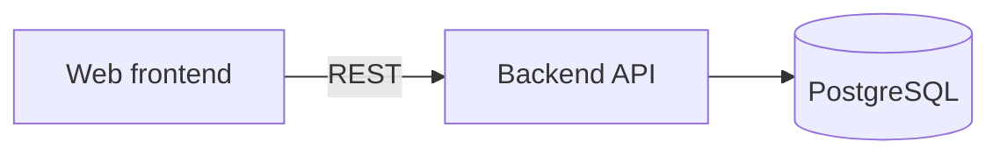
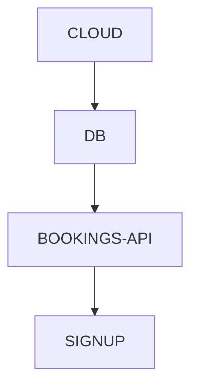

# Docs Management

<!--
Header comment (Markdown has no native comment syntax, so this HTML comment stands in for one):
the canonical vault schema shipped by the Blueprint plugin, v2. Every other Blueprint skill and
agent points here instead of carrying its own copy. The hooks (file-watcher, one-way-guard,
orientation, step-close) parse exactly the formats defined below, so the block format, the
Decided-by values and the folder names are an interface, not a style choice. Change them only
together with hooks/.
-->

The single source of truth for how a Blueprint project's documentation is laid out. The **main
session is the only writer** of authoritative vault files. Agents (specialists, `sheet-designer`,
`profile-updater`) may read the vault; none of them writes it.

## 1. Hierarchy — what sits on top

The vault has three levels. Keep them visibly separate:

1. **`_architecture.md`** — the entry point. Goal, global defaults, components and how they
   communicate, the dependency graph, and links to every foundation area and contract.
2. **Foundations and contracts** — the shared choices that are expensive to get wrong
   (`foundations/`, `contracts/`).
3. **Sections** — pieces of user value that *use* the foundations (`sections/`).

Inside every area and section, decisions are split by who made them:
- the main file (`AREA.md`, `SECTION.md`) holds decisions the user made or confirmed, rules,
  inherited/discovered decisions, and every one-way decision;
- `AREA--details.md` / `SECTION--details.md` holds **only** two-way decisions Claude made on its own
  (the user agent). It is the lowest level of the hierarchy.

Tags give each level its own colour in Obsidian's graph (§6).

## 2. Structure

```
vault-<project>/
├── .gitignore               (derived files — see §3)
├── _index.md                map of every file
├── _architecture.md         TOP: goal, defaults, components, graph, areas, contracts
├── _sections.md             table of sections
├── _current-task.md         the discussion in progress
├── _full-context.md         full discussion record (hook-written, not versioned)
├── _audit.md                decision changelog (hook-written)
├── _queue.json              the path (§7)
├── _plans.md                list of implementation phases
├── plans/                   PHASE-N-NAME.md, PHASE-N-NAME--substep.md, PHASE-N-NAME.json
├── local-profile.md         who decides each area: user / claude
├── management-info.md       project rules and preferences (optional)
├── _doc-rules.md            rules on how to write these docs (optional)
├── foundations/
│   ├── DB/
│   │   ├── DB.md            foundation decisions (user, rule, inherited, one-way)
│   │   └── DB--details.md   two-way decisions made by Claude
│   └── INTEGRATIONS/
│       └── <SYSTEM>.md      one file per external system: facts, unknowns, whom to ask
├── contracts/
│   └── <NAME>.md            one contract per file (API, types, events)
├── sections/
│   └── SIGNUP/
│       ├── SIGNUP.md
│       └── SIGNUP--details.md
├── Vocabulary/
│   ├── registry.json        shared question ids
│   ├── dismissed.json       findings the user ruled not real
│   └── ignored-values.json  absent-answer values the value-inversion check skips
├── _index/                  derived: decisions.json, unassigned.json, shadow files
└── Sheets/                  optional: engineering-sheets.html
```

- The vault folder is named after the project (`vault-<project>/`), never a generic `vault/`.
- A v1 vault's `features/` folder is still read by the hooks, but v2 never creates it.
- Create files with the `Write` tool (it creates parent folders). Never build files with shell
  redirection: on Windows it can produce UTF-16 files that every reader then sees as garbage.

## 3. What is versioned

**The vault is committed by default.** Every git worktree then holds the foundations at the
version of its own branch, git history records every change, and a merge gate can protect contract
files by path. A project that must keep the vault private (someone else's repo, an NDA) adds the
folder to its own `.gitignore` — accepting that parallel worktrees won't see it.

**The code and the vault live in the same repository.** This is fixed, not a decision to discuss.
Never decide — not even in an area Claude owns — to put the application code in a separate
repository "away from the vault": worktrees, parallel sessions and the merge gate only see the
vault when it sits next to the code. If the user explicitly wants two repositories, that is a
one-way decision: raise it with the user, explain what is lost (parallel sessions no longer read
the foundations), and record it with `Decided by: user`.

The rule behind the table is **"re-derivable → not versioned"**:

| File | Versioned? | Why |
|---|---|---|
| Every `.md` in the vault (except `_full-context.md`) | yes | Original content |
| `Vocabulary/*.json`, `_queue.json`, `plans/*.json` | yes | Original data |
| `_audit.md` | yes | Machine-written but not re-derivable: the who/when/what history |
| `**/atoms.json` | no | Derived from the Markdown blocks by the hook |
| `**/modules.json`, `_index/` | no | Derived; rebuilt in a second |
| `_full-context.md` | no | Machine-only, grows without bound |

The vault's own `.gitignore`, created by `/blueprint`:

```gitignore
_index/
_full-context.md
**/atoms.json
**/modules.json
```

## 4. Naming

| Type | Convention | Example |
|---|---|---|
| Foundation area | `foundations/AREA/AREA.md` — caps, hyphens | `foundations/CI-CD/CI-CD.md` |
| Area details | `foundations/AREA/AREA--details.md` | `foundations/DB/DB--details.md` |
| External system | `foundations/INTEGRATIONS/SYSTEM.md` | `foundations/INTEGRATIONS/STRIPE.md` |
| Contract | `contracts/NAME.md` — caps, hyphens | `contracts/BOOKINGS-API.md` |
| Section | `sections/SECTION/SECTION.md` | `sections/SIGNUP/SIGNUP.md` |
| Section details | `sections/SECTION/SECTION--details.md` | `sections/SIGNUP/SIGNUP--details.md` |
| Phase | `plans/PHASE-N-NAME.md` | `plans/PHASE-1-SETUP.md` |
| Decision id | lowercase kebab-case | `db-engine` |

What makes something an area, a contract or a section is decided by the tests in
`blueprint:using-blueprint`. They are not restated here.

## 4b. Language of the vault

**Write the vault in the language the user speaks with you** — prose, headings, questions in the
block headings, and the block keys. An Italian-speaking user gets an Italian vault. `_doc-rules.md`
can override this ("write the vault in English").

What stays in English in every language, because tools read it: folder and file names
(`foundations/`, `DB--details.md`), frontmatter tags (`foundation`, `details`), decision ids
(`db-engine`), and the values `one-way` / `two-way` and `claude`.

Italian keys and values (the hooks accept both languages; never mix them inside one block):

| English | Italian |
|---|---|
| `Choice` | `Scelta` |
| `Reversibility` | `Reversibilità` (values stay `one-way` / `two-way`) |
| `Decided by` — `user` / `claude` / `rule` / `discovery` / `inherited` | `Deciso da` — `utente` / `claude` / `regola` / `scoperta` / `ereditata` |
| `Rejected` | `Alternative scartate` |
| `Why` | `Perché` |
| `Depends on` | `Dipende da` |
| `Used by` | `Usata da` |
| `Facts` | `Fatti` |

The same block in an Italian vault:

```markdown
### db-engine — Quale database usa il sistema?
- **Scelta:** PostgreSQL (Azure Flexible Server)
- **Reversibilità:** one-way
- **Deciso da:** utente (2026-11-04)
- **Alternative scartate:** Cosmos DB — costo e query relazionali; SQLite — niente accessi contemporanei
- **Perché:** i dati sono relazionali (ordini, utenti) e le query sono SQL standard
- **Dipende da:** cloud-provider
- **Usata da:** SIGNUP, ORDER-HISTORY
```

The templates in §12 are written in English; translate their headings too (for example
`## What it covers` → `## Cosa copre`, `## Decisions` → `## Decisioni`, `## Links` → `## Link`).

## 5. Decision blocks — the only source of decisions

Every decision is written once, in Markdown, as a level-3 heading followed by a list with fixed
keys. The hook derives the machine-readable atoms from these blocks; nobody writes `atoms.json` by
hand.

```markdown
### db-engine — Which database engine does the system use?
- **Choice:** PostgreSQL (Azure Flexible Server)
- **Reversibility:** one-way
- **Decided by:** user (2026-11-04)
- **Rejected:** Cosmos DB — cost and relational queries; SQLite — no concurrent access
- **Why:** the data is relational (orders, users) and queries are standard SQL
- **Depends on:** cloud-provider
- **Used by:** SIGNUP, ORDER-HISTORY
```

**Heading:** `### <id> — <question>`. The separator is an em dash `—`; ` - ` is also accepted.
`<id>` is lowercase kebab-case. It is the decision's question id in `Vocabulary/registry.json`.
The question is written in full ("which database engine does the system use?"), never a bare noun:
a noun like `db` invites two different questions to collide under one id.

**Keys:**

| Key | Required | Content |
|---|---|---|
| `Choice` | yes | the value decided |
| `Reversibility` | yes | `one-way` (hard or expensive to change later) or `two-way` |
| `Decided by` | yes | one of the five values below, optional date in parentheses |
| `Why` | yes | short reasoning. For a **two-way** decision in a foundation area or a contract, it also says *why* it is easy to change (e.g. "two-way: no stored data depends on it, switching is a config change") |
| `Rejected` | yes if one-way | alternatives really weighed, each with a short reason, separated by `;` |
| `Depends on` | no | other decision ids this one presumes, separated by `,` |
| `Used by` | no | section names that rely on this decision, separated by `,` |
| `Facts` | no | secondary properties useful to later checks |

The parser also accepts the Italian keys and `Deciso da` values listed in §4b.

**`Decided by` values:**

| Decided by | Internal status | Meaning | Where the block goes |
|---|---|---|---|
| `user` | `ratified` | the user made or confirmed it | main file |
| `claude` | `agent-approved` | Claude decided it alone (user agent); **two-way only** | `--details.md` |
| `rule` | `locked` | a rule from `management-info.md` | main file |
| `discovery` | `inferito` | found in the code, with an inferable reason; awaits ratification | main file |
| `inherited` | `ereditato-ignoto` | inherited, no known reason; awaits ratification | main file |

- "Counts as decided" means `user` or `rule`. Everything else is a guess until ratified.
- A `claude` block marked `one-way` is **blocked** by the one-way guard before it is written. The
  fix is to ask the user and write `Decided by: user`, never to relabel the reversibility.
- A block whose heading parses but whose keys are missing or invalid (no `Choice`, a one-way block
  without `Rejected`, an unknown `Decided by`) does not silently disappear: the hook reports it.
- Prose around the blocks is free. A file can have `##` sections (for example `## Added for MVP2`)
  — the parser reads every `###` block regardless of which `##` it sits under.
- A decision added to an existing area because another area or section needed it (an
  **addition**) goes under a `## Added for <stage>` heading, so the area reads as "MVP1 needs X,
  MVP2 adds Y".

**Never shown to the user.** These blocks are bookkeeping for the vault. In conversation, the user
only ever sees decisions in plain words (see `blueprint:using-blueprint`, hard rule 2).

## 6. Frontmatter tags and colours

Every vault Markdown file begins with YAML frontmatter carrying exactly one type tag:

| File | Tag |
|---|---|
| `_*.md`, `local-profile.md`, `_doc-rules.md`, `management-info.md` | `index` |
| `foundations/AREA/AREA.md`, `foundations/INTEGRATIONS/*.md` | `foundation` |
| `contracts/*.md` | `contract` |
| `sections/SECTION/SECTION.md` | `section` |
| `*--details.md` | `details` |
| `plans/PHASE-N-NAME.md` / `--substep.md` | `phase` / `substep` |
| holds unconfirmed content (Discovery drafts, inherited decisions) | add `needs-review` |
| a future, not-yet-built placeholder | add `parked` |

Recommended Obsidian graph groups (Graph view → Settings → Groups):
`tag:#foundation` red · `tag:#contract` orange · `tag:#section` blue · `tag:#details` light grey ·
`tag:#index` grey · `tag:#phase` green · `tag:#needs-review` yellow · `tag:#parked` muted orange.

**Diagrams use Mermaid** fenced blocks, never ASCII art. Obsidian renders Mermaid natively.

## 7. `_queue.json` — the path

The path is the ordered list of steps. Discussion is only one kind of step.

```json
{ "mode": "B", "entries": [
  { "id": "db", "kind": "discuss", "scope": "foundation", "target": "DB",
    "description": "Which database, hosting and backups", "importance": 5, "status": "pending" },
  { "id": "backend-build", "kind": "build", "scope": "section", "target": "SIGNUP",
    "profile": "backend", "skills": ["superpowers:test-driven-development"],
    "runner": "session", "done_when": "signup API passes its acceptance tests",
    "status": "pending" }
]}
```

| Field | Values |
|---|---|
| `mode` | `A` (decide everything, then build) · `B` (Claude proposes the path, the user confirms — default) · `C` (the user writes the path) |
| `kind` | `discuss` · `prototype` · `mockup` · `build` |
| `scope` | `foundation` · `contract` · `section` · `note` · `plan` |
| `target` | the area, contract or section name |
| `importance` | 1–5, optional; sets how many specialists a discussion gets |
| `profile`, `skills`, `runner`, `done_when` | build / prototype / mockup steps only; `runner` is `session` or `mother` |
| `status` | `pending` · `in-progress` · `done` |

The array order is the path order. Items found later are inserted into the existing order, never
trigger a full re-proposal. A starting file is `{ "mode": "B", "entries": [] }`.

## 8. How the hooks talk

Every hook message starts with `[Blueprint]` and reaches the session that made the write — which,
since the main session is the only writer, is the main conversation.

| Hook | Event | Channel | What it does |
|---|---|---|---|
| `orientation` | SessionStart | `additionalContext` | Short state: current path step, a discussion to resume, essential rules, digest of confirmed one-way decisions |
| `one-way-guard` | PreToolUse (Write/Edit) | `permissionDecision: "deny"` | Blocks a vault file that would contain a `one-way` block with `Decided by: claude` |
| `file-watcher` | PostToolUse | `additionalContext` | Derives atoms from the blocks, runs the checks, mirrors `_current-task.md`, keeps the module map and the audit |
| `step-close` | Stop | `decision: "block"` + `reason` | At the end of a step that changed code owned by an area or section with decisions: asks once whether the work changed the foundations |

**Findings are presented, never resolved alone.** Explain each `[Blueprint]` finding to the user
in plain words ("the database we picked for SIGNUP clashes with the one in DB"), group them with
conflicts first, and let the user decide before anything is changed, dismissed or added to
`ignored-values.json`.

## 9. Derived atoms and the checks

On every write of a `.md` in `foundations/`, `contracts/`, `sections/` (or a v1 `features/`), the
file-watcher reads every block in that folder's Markdown files and writes the folder's derived
`atoms.json`. Then it recompiles `_index/decisions.json` and runs the checks.

**Scope of the checks:** all atoms in `foundations/` and `contracts/`, plus the **one-way** atoms in
`sections/`. Claude's two-way details in sections are not checked.

| Check | Question it answers |
|---|---|
| Vocabulary | does every decision id exist in `Vocabulary/registry.json`? |
| Conflict | same id, different choice, in two different places? |
| Value inversion | the same literal choice answering two different ids? (skips `ignored-values.json`) |
| Orphan | does every `Depends on` point to an existing decision id? |
| Used by | does every name in `Used by` exist as a folder in `sections/`? |
| Unreadable block | a heading that parses, with missing or invalid keys |

These are real scripts, never Claude comparing JSON by reading it.

**Register before writing.** Add each genuinely new question to `Vocabulary/registry.json`
*before* writing its block. The vocabulary check then still catches the error it exists for (a
misspelled id) without flagging every new question.

**The audit.** `_audit.md` is appended by the hook on every change to the derived atoms (added /
changed / removed), with who (`git config user.name`, falling back to the OS user), when, the
session id and the `Why`. It also logs every one-way-guard block. Never hand-edited.

**Profile flag.** A newly derived `ratified` atom (a `Decided by: user` block) is flagged for
`profile-updater`. Only `user` decisions ever feed the global Profile.

**Module map.** The file-watcher keeps `modules.json` per area or section (the source files it
owns) and `_index/unassigned.json` (source files owned by nobody yet). It ignores `docs/`,
`.superpowers/`, `.claude/`, `node_modules/`, `prototypes/`, lock files, and `.md` files outside
the vault. `step-close` uses this map to decide whether a step touched code that has decisions.

## 10. `_current-task.md` and `_full-context.md`

`_current-task.md` is the live discussion log for **one topic at a time**. The unit written into it
is "a decision was reached", written the moment it happens, never batched. One block per decision:
the chosen option, why, pros, cons, known risks. If a decision is revised, the entry shows the
current answer only. It is cleared once the whole topic is discussed and written to its permanent
home.

`_full-context.md` is the full record. The hook keeps a shadow copy of `_current-task.md` in
`_index/` and, on every change, compares old and new and appends **only the new lines**, with a
timestamp. So:
- a full rewrite of `_current-task.md` loses nothing;
- clearing it appends nothing;
- a change made through Bash is caught too (the hook compares the file on every PostToolUse).

Read `_full-context.md` only when strictly necessary — a hallucination, a repeated mistake, a clear
misunderstanding with the user. Never write it directly.

## 11. The save sequence

The main session writes; nothing else does. When a discussion settles:

1. **Register** every genuinely new question id in `Vocabulary/registry.json`.
2. **Write the blocks.** `Decided by: user` (and rule / discovery / inherited) blocks go in the main
   file; Claude's two-way blocks go in `--details.md`. Use `Write` or `Edit`, never shell
   redirection.
3. **Read the hook messages** returned by those writes: a guard denial, unreadable blocks, check
   findings, `Used by` warnings.
4. **Resolve with the user.** Guard denial → ask the user about that decision in plain words, then
   rewrite it as `Decided by: user`. Findings → explain them, let the user decide, then fix.
5. **Update the overview files:** `_architecture.md` (areas, contracts, graph), `_sections.md`,
   `_index.md`, `_queue.json` (check the step off). Clear `_current-task.md` when the topic is done.
6. **Only then** tell the user it is locked ("✓ Locked."). Never before every write has succeeded
   and every finding is resolved.

Before every write, read `_doc-rules.md` if it exists (and `~/.claude/blueprint/doc-rules.md` for
rules valid in every project; the project file wins on conflicts).

## 12. File templates

### `_architecture.md`
````markdown
---
tags: [index]
---

# Architecture

## Goal and focus
What the project is for, in a few sentences.

## Global defaults
Defaults every section inherits (e.g. resilience, security, scale targets).

## Components and how they communicate


## Dependency graph


## Foundation areas
| Area | Covers | Status |
|---|---|---|
| [[DB]] | engine, hosting, backups, migrations | locked |

## Contracts
| Contract | Exposed by | Used by |
|---|---|---|
| [[BOOKINGS-API]] | backend | SIGNUP, ADMIN |

## Baseline
(Discovery only) `main` at `<sha>` on `<date>`.

## Unconfirmed decisions
Areas still holding `discovery` / `inherited` blocks: [[...]]
````

### `_sections.md`
```markdown
---
tags: [index]
---

# Sections

| Section | Depends on | Contracts used | Contracts exposed | Owned paths | Acceptance tests | Status |
|---|---|---|---|---|---|---|
| [[SIGNUP]] | DB, AUTH | BOOKINGS-API | — | `web/src/signup/` | `tests/acceptance/signup/` | pending |
```
"Owned paths" are the files only this section may touch; a merge gate checks them.

### `local-profile.md`
```markdown
---
tags: [index]
---

# Local Profile

## Who decides each area
- DB: user
- CI-CD: claude

## Focus
- Cares most about: DB, AUTH
```
`user` = the user discusses that area; `claude` = the user agent decides its two-way details, and
every one-way decision still comes back to the user. The user can change any line at any time.
Never update it silently.

### `foundations/AREA/AREA.md`
```markdown
---
tags: [foundation]
---

# DB

## What it covers
Engine, hosting, backups, migrations.

## Decisions
### db-engine — Which database engine does the system use?
- **Choice:** ...

## Added for MVP2
### orders-table — ...

## Links
- [[DB--details]] · [[_architecture]] · [[SIGNUP]]
```

### `*--details.md`
```markdown
---
tags: [details]
---

# DB — details decided by Claude

Two-way decisions Claude made on its own. Any of them can be promoted to a user decision.

### db-connection-pool — How large is the connection pool?
- **Choice:** 10
- **Reversibility:** two-way
- **Decided by:** claude (2026-11-04)
- **Why:** default for the expected load
```

### `contracts/NAME.md`
```markdown
---
tags: [contract]
---

# BOOKINGS-API

## Exposed by / used by
Backend → SIGNUP, ADMIN.

## Shape
Endpoints, types or events, as a table or a short schema.

## Decisions
### api-style — Which API style do the frontend and backend use?
- ...
```
A contract changes only through a discussion (a revision), never as a side effect of building a
section.

### `sections/SECTION/SECTION.md`
```markdown
---
tags: [section]
---

# SIGNUP

## What the user gets
## Uses
Foundations and contracts it relies on: [[DB]], [[BOOKINGS-API]].
## Adds to the foundations
What it needs that a foundation area now holds (written there too, under `## Added for <stage>`).
## Owned paths and acceptance tests
## Decisions
```

### `foundations/INTEGRATIONS/SYSTEM.md`
```markdown
---
tags: [foundation, needs-review]
---

# STRIPE

## What it is and who uses it
## Where its code and docs live
Repos, paths, classes, links.
## Calls we use
Endpoint or method, parameters, data shapes — as found.
## Known unknowns
Written explicitly: "error codes of refunds: we don't have them".
## Examples to copy
## Open questions for its owner
Who to ask, and what.
## Decisions
```

### `_index.md`
```markdown
---
tags: [index]
---

# Vault Index

## Top
- [[_architecture]] · [[_sections]] · [[local-profile]] · [[_current-task]] · [[_plans]]
- `_queue.json` — the path · `_audit.md` — decision changelog
## Foundations
- [[DB]] · [[DB--details]]
## Contracts
- [[BOOKINGS-API]]
## Sections
- [[SIGNUP]]
## Plans
- [[PHASE-1-NAME]]
```
A map and nothing else: no descriptions, no status prose. Update it on every file add or remove.

### `_current-task.md`
```markdown
---
tags: [index]
---

# Current Task

## Now discussing — <AREA or SECTION> (<date>)

### <the decision just reached>
- **Chosen:** ...
- **Why:** ...
- **Pros:** ...
- **Cons:** ...
- **Risks:** ... or "none identified"
```
These are working notes, not decision blocks: they use `Chosen`, not `Choice`, and the hook does
not parse them.

### `_doc-rules.md`
Plain Markdown, one rule per bullet ("every external API gets a table of its error codes", "write
the vault in Italian"). Read before every vault write. Never compiled into decisions.

### `Vocabulary/` — exact shapes
Read by hook code: a wrong shape fails silently.
```json
// Vocabulary/registry.json
{ "entries": [ { "id": "db-engine", "question": "which database engine does the system use?" } ] }
```
```json
// Vocabulary/dismissed.json
{ "entries": [ { "id": "d-001", "title": "<the finding, verbatim>", "features": ["DB", "SIGNUP"],
                 "date": "2026-11-04", "reason": "<why it is not real>" } ] }
```
```json
// Vocabulary/ignored-values.json — the starter seed, verbatim
{ "values": ["none", "n/a", "not-applicable", "default", "standard", "disabled", "tbd"] }
```
Empty lists use `{ "entries": [] }`, never a bare `[]`. Never add `yes` or `no` to the ignored
values: a yes/no choice means the question was written wrong, which is worth surfacing.

### `_plans.md`, `plans/PHASE-N-NAME.md`, `plans/PHASE-N-NAME.json`
As in v1: `_plans.md` lists phases with one line each; a phase file has Scope, Steps, Linked areas
and sections; the JSON holds tasks with `id`, `description`, `exit_criterion` (machine-verifiable),
`depends_on`, `status`.

## 13. Engineering sheets (optional)

`Sheets/engineering-sheets.html` is a derived, non-authoritative picture of the vault: Sheet 0 for
the whole project plus one sheet per foundation area and section. It is rendered by
`sheet-designer` only after the user says yes (see `blueprint:engineering-sheets`). It never writes
a vault Markdown file.

## 14. When to read

- Session start: `_index.md`, `_current-task.md`, `_queue.json` (the orientation hook summarises
  them).
- Before building a section: its `SECTION.md`, the contracts it uses, the foundation areas it
  depends on — that is the section's slice, nothing more.
- Architectural doubt: `_architecture.md` first.
- Before locking a decision: `Vocabulary/registry.json`, to reuse an existing id.
- Only when strictly necessary: `_full-context.md`.

## 15. Not part of this schema

- No mandatory HTML recap per area.
- No assumed `PROGRESS.md`.
- No hand-written `atoms.json`: the Markdown blocks are the only source.
- The area / contract / section tests and Ratification-at-Contact live in
  `blueprint:using-blueprint`, never restated here.
